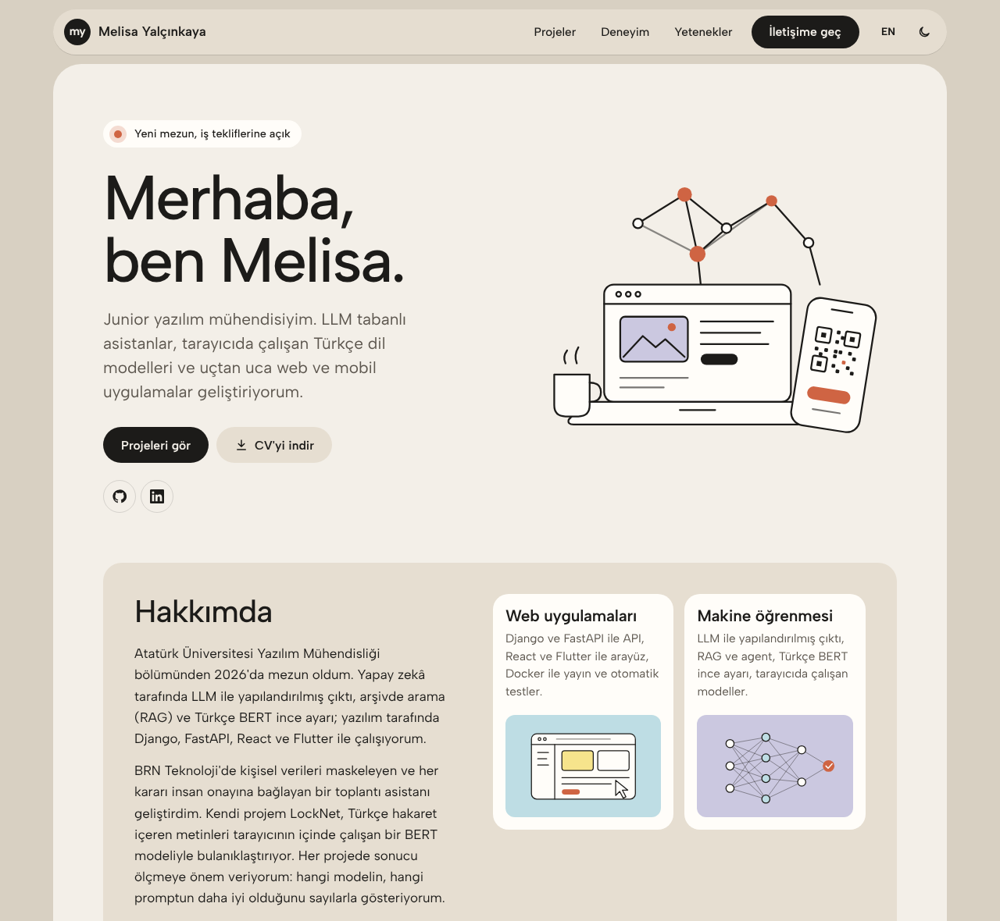
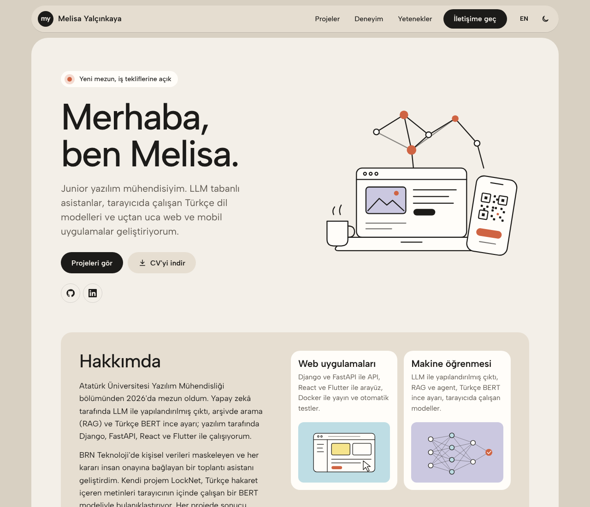
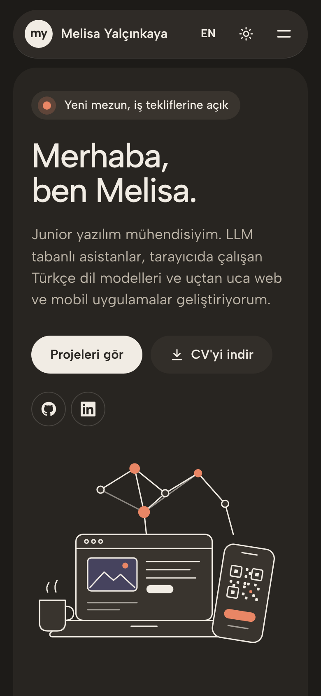

# Melisa Yalçınkaya | Portfolyo

[](https://github.com/melisayalcinkaya/portfolio/actions/workflows/ci.yml)


[](LICENSE)

Junior yazılım mühendisi Melisa Yalçınkaya'nın kişisel sitesi: projeler, deneyim, yetenekler, akademik yayın ve indirilebilir CV.

**🔗 Canlı site: [melisayalcinkaya.github.io/portfolio](https://melisayalcinkaya.github.io/portfolio/)**



| Projeler | Telefonda, koyu tema |
|---|---|
|  |  |

## Özellikler

- **Türkçe ve İngilizce:** Tarayıcı diline göre açılır, üst menüdeki düğmeyle değişir. "CV'yi indir" seçili dildeki CV'yi indirir.
- **Açık ve koyu tema:** Sistem ayarını izler, seçim hatırlanır. Tema sayfa boyanmadan önce uygulanır, yanıp sönme olmaz.
- **Projeler:** Kurumsal İletişim Asistanı, LockNet ve QR Menü öne çıkan kartlarda; SkinSavvy, QR Yoklama ve ATASENG ızgarada. Canlı demo, kaynak kod ya da "özel depo" notu.
- **Kendi çizimleri:** Eski şablondaki fotoğraf ve ikonların yerine bu site için çizilmiş satır içi SVG illüstrasyonlar. Ek istek yapmaz, temaya göre renk değiştirir. Eski sürümdeki ~5 MB'lık görseller kaldırıldı; sayfanın tamamı yaklaşık 140 KB (gzip, yazı tipiyle).
- **Erişilebilirlik:** "İçeriğe geç" bağlantısı, görünür klavye odağı, `aria-expanded` bildiren menü düğmesi (Escape ile kapanır), azaltılmış hareket tercihine saygı.
- **Paylaşım kartı:** LinkedIn veya WhatsApp'ta bağlantı paylaşılınca görünen önizleme görseli (Open Graph).
- **CV üretimi:** CV'ler `scripts/cv-data.mjs` dosyasından PDF olarak üretilir; site ile CV aynı kaynaktan beslenir.

## Gizlilik

Site herkese açık olduğu için **telefon numarası ve referans iletişim bilgileri yayımlanmaz**. Sitedeki CV'de referanslar için "Talep üzerine sağlanır" yazar.

Başvurular için telefonlu ve referanslı kişisel CV, depoya hiç girmeyen yerel bir dosyadan üretilir:

```bash
npm run cv                                              # public/ içine web sürümleri
npm run cv -- --private ~/cv.private.json --out ~/cv    # kişisel sürüm (depoya girmez)
```

`tests/content.test.js` site metinlerinde ve CV verisinde telefon numarası ya da referans bilgisi bulursa CI'ı başarısız yapar.

## Kurulum

```bash
npm install
npm run dev        # http://localhost:5173
npm run build      # dist/ klasörüne derler
```

Metinleri değiştirmek için yalnızca [`src/content.js`](src/content.js) dosyasını düzenlemek yeterli.

## Testler

```bash
npm run lint
npm test           # Vitest: dil/tema geçişi, menü, bağlantılar, gizlilik, çeviri tutarlılığı
npm run e2e        # Playwright: 320 / 390 / 1280 px, açık ve koyu temada yatay taşma ve konsol hatası
```

## Yayın

`main` dalına her push'ta GitHub Actions lint, birim ve tarayıcı testlerini çalıştırır; hepsi geçerse siteyi GitHub Pages'e yayınlar. Vite `base: './'` ile derlendiği için depo adı değişse de site çalışır.

## Proje yapısı

```
src/
  content.js          # tüm metinler (TR + EN)
  prefs.jsx           # dil ve tema tercihleri
  components/         # Header, Hero, Projects, Experience, Skills, Contact
  illustrations/      # çizgi illüstrasyonlar (SVG)
scripts/
  cv-data.mjs         # CV içeriği
  build-cv.mjs        # CV PDF üretimi
public/               # CV PDF'leri, favicon, paylaşım görseli
tests/ e2e/           # Vitest ve Playwright testleri
```

## English summary

Personal portfolio of Melisa Yalçınkaya, junior software engineer. A single-page React + Vite site with Turkish/English content, light/dark themes, hand-drawn inline SVG illustrations and CV PDFs generated from the same data. Phone numbers and reference contacts are deliberately kept out of the public site and enforced by tests. CI runs ESLint, Vitest and Playwright (overflow checks at 320/390/1280 px in both themes) and deploys to GitHub Pages.

## Lisans

[MIT](LICENSE)
